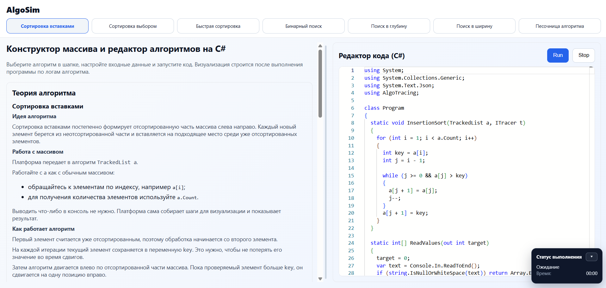
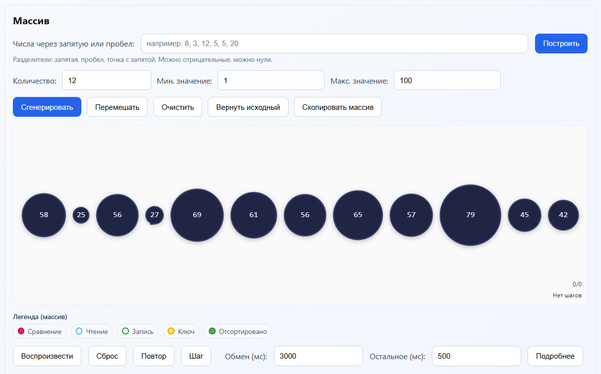
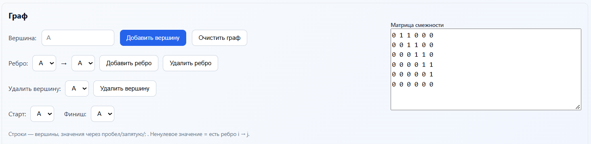
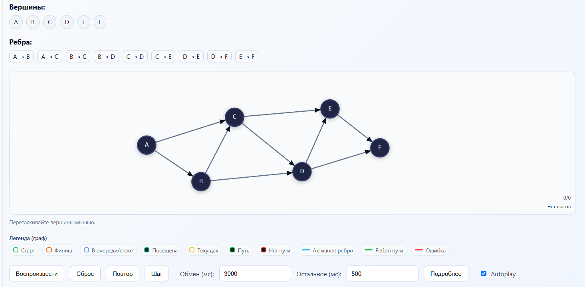
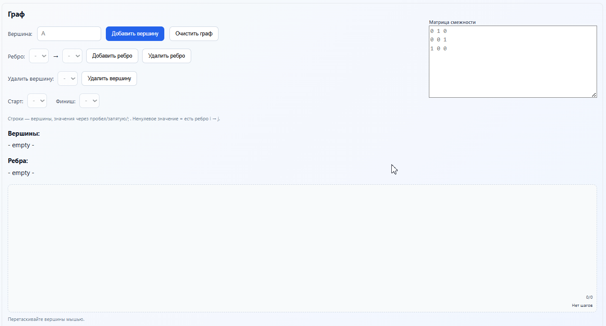
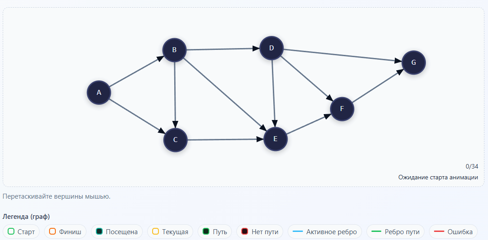
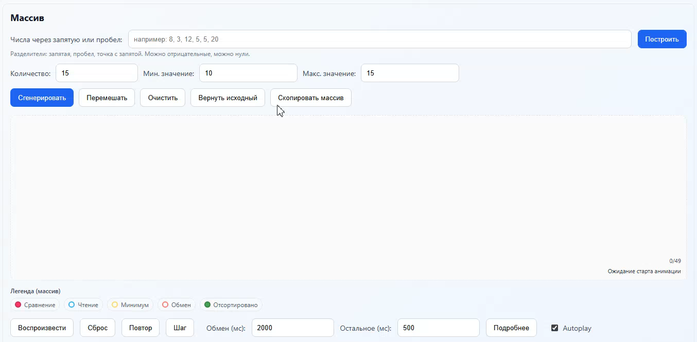
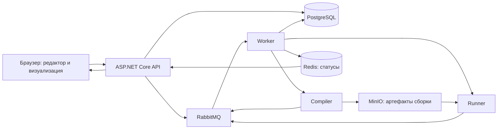

# AlgoSim

**Веб-платформа для изучения алгоритмов на C# через собственный код и пошаговую визуализацию.**

AlgoSim связывает теорию, редактор кода и анимацию в одном интерфейсе. Можно выбрать готовый алгоритм, изменить его реализацию, задать массив или граф и увидеть, как программа сравнивает элементы, переставляет значения и проходит по вершинам.

Проект подходит для самостоятельного изучения алгоритмов, демонстраций на занятиях и экспериментов со своими реализациями.

> Визуализация строится **после выполнения программы** по записанным событиям. Для получения шагов код использует библиотеку `AlgoTracing`; готовые шаблоны уже содержат необходимую настройку.



*Теория выбранного алгоритма и его реализация доступны рядом в одном интерфейсе.*

## Возможности

- **Редактор C# на базе Monaco:** готовые программы с `Main`, чтением входных данных и функцией алгоритма, которую можно менять.
- **Теория рядом с кодом:** описание алгоритма, последовательность действий, сигнатуры и подсказки по трейсингу.
- **Редактор массива:** ручной ввод, случайная генерация, перемешивание и восстановление исходных данных.
- **Редактор направленного графа:** добавление и удаление вершин и рёбер, ввод матрицы смежности, выбор старта и финиша, перемещение вершин мышью.
- **Управление анимацией:** воспроизведение, пауза, сброс, переход по шагам, Autoplay и настройка длительности отдельных операций.
- **Подсветки и список шагов:** сравнения, чтения, записи, обмены, рабочие диапазоны, посещённые вершины и найденный путь.
- **Запуск и диагностика:** статусы очереди, компиляции и выполнения, таймеры, сообщения об ошибках, отмена задания через `Stop` и экспорт исходных логов.
- **Свои реализации:** изменение готового алгоритма и пустые шаблоны для самостоятельного написания кода.

Подробный пользовательский сценарий описан в [руководстве пользователя](USER_GUIDE.md). В актуальном интерфейсе `Stop` также отправляет запрос отмены на сервер, а скорость задаётся длительностями операций в миллисекундах.

## Интерфейс

### Работа с массивом

Массив можно ввести вручную или сгенерировать, перемешать и вернуть к исходному состоянию. Под сценой находятся легенда подсветок и управление воспроизведением.



### Построение графа

Граф задаётся вершинами и направленными рёбрами или матрицей смежности. Для поиска маршрута выбираются стартовая и конечная вершины.



### Сцена графа

На сцене отображаются вершины и направления рёбер. Легенда объясняет состояния обхода и подсветку пути, а панель воспроизведения позволяет изучать записанные шаги. На скриншоте показан граф до запуска алгоритма.



## Демонстрации

### Построение графа

Добавление вершин и направленных рёбер с отображением матрицы смежности и сцены графа.



### Обход в ширину (BFS)

Пошаговый обход графа: подсветка текущей и посещённых вершин, обработка рёбер и отображение результата поиска пути.



### Сортировка выбором

Настройка массива и воспроизведение шагов сортировки выбором. Нажмите на превью, чтобы открыть видео в формате MP4.

[](docs/media/selection-sort.mp4)

[Открыть видео сортировки выбором (MP4)](docs/media/selection-sort.mp4)

## Доступные алгоритмы

| Алгоритм | Что показывает визуализация |
| --- | --- |
| Сортировка вставками | Выбор очередного элемента, сдвиги и рост отсортированной части |
| Сортировка выбором | Поиск минимального элемента и обмен с началом неотсортированной части |
| Быстрая сортировка | Опорный элемент, разбиение массива и обработка поддиапазонов |
| Бинарный поиск | Сужение диапазона, проверка среднего элемента и результат поиска |
| Поиск в глубину (DFS) | Обход графа и поиск маршрута между выбранными вершинами |
| Поиск в ширину (BFS) | Обход по уровням и кратчайший путь по числу рёбер |

Для бинарного поиска интерфейс предварительно сортирует массив. BFS работает с невзвешенным графом; кратчайший путь определяется количеством рёбер.

## Как пользоваться

1. Откройте симулятор и выберите алгоритм.
2. Прочитайте теорию и настройте входные данные. Для графа укажите стартовую и конечную вершины.
3. Выберите режим анимации и изучите готовый шаблон C#.
4. Измените реализацию или оставьте шаблон для первого запуска.
5. Нажмите `Run` и дождитесь результата компиляции и выполнения.
6. Воспроизведите анимацию целиком или пройдите её по шагам, сопоставляя события с кодом.

### Два режима анимации

| Режим | Как формируются шаги |
| --- | --- |
| Авто-анимация | Отслеживаемые структуры данных записывают операции. Для массива используется `TrackedList`, для графа — отслеживаемые списки смежности, очередь, стек и состояния посещения |
| Контролируемая анимация | Код явно задаёт события и подсветки через `ITracer` и `TracingExtensions` |

Авто-анимация помогает сосредоточиться на реализации алгоритма. Контролируемый режим позволяет точнее задать последовательность объясняющих шагов. Степень автоматизации зависит от выбранного шаблона: обычные коллекции без трейсинга сами по себе не создают события.

## Как устроен проект



1. API сохраняет отправленный код и входные данные в PostgreSQL, затем ставит задание в RabbitMQ.
2. Worker определяет, нужна ли компиляция или можно повторно использовать готовый артефакт.
3. Compiler собирает C#-программу в отдельном контейнере и сохраняет результат сборки в S3-совместимое хранилище MinIO.
4. Runner выполняет собранную программу в отдельном контейнере и возвращает вывод, ошибки и сведения о выполнении через очередь.
5. Worker сохраняет результат и обновляет статус. Браузер опрашивает API, получает логи и воспроизводит события `AlgoTracing`.

`JsonConsoleTracer` записывает события в стандартный вывод с префиксом `__STEP__`. Клиент разбирает их и строит визуализацию массива или графа.

### Стек

| Часть | Технологии |
| --- | --- |
| Интерфейс | HTML, CSS, JavaScript, SVG, Monaco Editor, GSAP |
| API и фоновые сервисы | C#, .NET 10, ASP.NET Core |
| Хранение данных | PostgreSQL 16, Entity Framework Core, Npgsql |
| Статусы и очереди | Redis 7, RabbitMQ 3.13 |
| Артефакты компиляции | MinIO, S3 API |
| Выполнение кода | Docker, runtime `runsc` (gVisor) по умолчанию |
| Тесты | xUnit, ASP.NET Core WebApplicationFactory, EF Core InMemory |

Для контейнеров пользовательского кода предусмотрены отключённая сеть, файловая система только для чтения, временные каталоги, запуск непривилегированным пользователем и ограничения CPU, памяти, процессов и времени выполнения. В Compose тайм-аут компиляции по умолчанию — 180 секунд, выполнения — 25 секунд.

## Локальный запуск

### Требования

- Git.
- Docker с Linux-контейнерами и Docker Compose.
- Установленный и зарегистрированный в Docker runtime `runsc` для Compiler и Runner.
- Python 3 или другой HTTP-сервер для статического интерфейса.
- Доступ к интернету для загрузки образов и зависимостей. Monaco Editor и GSAP загружаются браузером с CDN.

.NET 10 SDK на хосте нужен для сборки и тестов вне Docker; контейнерные сборки используют SDK из образа.

> **Состояние текущей ветки:** в репозитории отсутствует реализация `Sha256ArtifactHasher`, зарегистрированная в `AlgoPlatform.Infrastructure/DependencyInjection.cs`. Перед полноценной сборкой серверной части нужно восстановить этот класс в пространстве имён `AlgoPlatform.Infrastructure.Artifacts`. Команды ниже описывают запуск после устранения этой проблемы.

### 1. Клонировать репозиторий

```sh
git clone https://github.com/Sluchaino/AlgoSim.git
cd AlgoSim
```

Все дальнейшие команды выполняются из корня репозитория.

### 2. Подготовить конфигурацию

PowerShell:

```powershell
Copy-Item AlgoPlatform.API/.env.example AlgoPlatform.API/.env
```

Linux / macOS:

```sh
cp AlgoPlatform.API/.env.example AlgoPlatform.API/.env
```

В `.env` уже перечислены необходимые параметры PostgreSQL, Redis, RabbitMQ, MinIO и сервисов выполнения. Замените демонстрационные пароли и согласуйте связанные настройки:

- `POSTGRES_*` и `ConnectionStrings__DefaultConnection`;
- `REDIS_PASSWORD` и пароль в `Redis__Connection`;
- `RABBITMQ_DEFAULT_*` и `RabbitMQ__User` / `RabbitMQ__Pass`;
- `MINIO_ROOT_*`, `AWS_ACCESS_KEY_ID` / `AWS_SECRET_ACCESS_KEY` и `S3__AccessKey` / `S3__SecretKey`.

Имена хостов `postgres`, `redis`, `rabbitmq` и `minio` используются внутри сети Compose. Файл `.env` исключён из Git.

### 3. Проверить runtime и запустить серверную часть

```sh
docker info --format '{{json .Runtimes}}'
```

В списке должен присутствовать `runsc`. Для Windows с Docker Desktop и WSL2 есть вспомогательный скрипт:

```powershell
./scripts/setup.ps1 -Up
```

Он регистрирует **уже установленный** runtime по пути `/mnt/docker-desktop-disk/gvisor/bin/runsc`, перезагружает конфигурацию Docker и запускает Compose. Сам бинарный файл `runsc` скрипт не устанавливает. Если runtime расположен иначе, используйте `scripts/enable-runsc.ps1 -RuntimePath <путь>`.

Для окружения, где `runsc` уже зарегистрирован:

```sh
docker compose --env-file AlgoPlatform.API/.env -f AlgoPlatform.API/docker-compose.yml config --quiet
docker compose --env-file AlgoPlatform.API/.env -f AlgoPlatform.API/docker-compose.yml up -d --build
```

API автоматически применяет миграции базы данных при старте. Интерфейс отдельно от серверной части; API не раздаёт каталог `frontend`.

### 4. Запустить интерфейс

В отдельном терминале:

```sh
python -m http.server 8080 --directory frontend --bind 127.0.0.1
```

Откройте:

- Главная страница: [http://localhost:8080/html/index.html](http://localhost:8080/html/index.html).
- Симулятор: [http://localhost:8080/html/algorithms.html](http://localhost:8080/html/algorithms.html).
- Swagger API: [http://localhost:5280/swagger](http://localhost:5280/swagger) при окружении `Development`.
- Проверка готовности: [http://localhost:5280/health](http://localhost:5280/health).

HTML использует относительные пути `../css` и `../js`, поэтому можно раздавать как `frontend`, так и весь репозиторий. Во втором случае адрес симулятора — `http://localhost:8080/frontend/html/algorithms.html`. При запуске на локальном порту `8080` клиент автоматически обращается к API на `http://localhost:5280`. Для другого адреса API настройте `window.RUNNER_BASE` в `frontend/js/core/config.js`.

Чтобы посмотреть интерфейс без серверной части, достаточно запустить этот HTTP-сервер. Стили, редактор и ввод данных доступны отдельно; кнопка `Run` требует работающего API, Compiler и Runner.

### Проверка сервисов и остановка

```sh
docker compose --env-file AlgoPlatform.API/.env -f AlgoPlatform.API/docker-compose.yml ps
docker compose --env-file AlgoPlatform.API/.env -f AlgoPlatform.API/docker-compose.yml logs --tail=100 api worker compiler runner
docker compose --env-file AlgoPlatform.API/.env -f AlgoPlatform.API/docker-compose.yml down
```

`down` сохраняет именованные тома PostgreSQL, Redis и MinIO. Консоли RabbitMQ и MinIO доступны на портах `15672` и `9001` соответственно; вход использует значения из `.env`.

## Структура репозитория

```text
AlgoSim/
├── frontend/
│   ├── html/                         # Главная страница и симулятор
│   ├── css/                          # Стили интерфейса
│   └── js/
│       ├── editor/                   # C#-шаблоны
│       ├── runner/                   # Отправка кода, статусы и логи
│       ├── ui/                       # Ввод данных и управление интерфейсом
│       └── viz/                      # Сцена и проигрывание алгоритмов
├── AlgoPlatform.API/
│   ├── AlgoPlatform/                 # HTTP API, Swagger, health checks
│   ├── AlgoPlatform.Application/     # Сервисы приложения и абстракции
│   ├── AlgoPlatform.Domain/          # Модели алгоритмов, заданий и артефактов
│   ├── AlgoPlatform.Infrastructure/  # База данных, очереди и хранилище
│   ├── AlgoPlatform.Contracts/       # Контракты сообщений выполнения
│   ├── AlgoPlatform.Worker/          # Обработка заданий и результатов
│   ├── AlgoPlatform.Compiler/        # Компиляция пользовательского кода
│   ├── AlgoPlatform.Runner/          # Выполнение и отмена заданий
│   ├── AlgoTracing/                  # Трейсинг массивов и графов
│   ├── AlgoPlatform.Tests.Integration/
│   ├── .env.example
│   └── docker-compose.yml
├── scripts/                          # Настройка runsc для Docker Desktop
└── USER_GUIDE.md                      # Руководство пользователя
```

## Основные API-маршруты

| Метод | Маршрут | Назначение |
| --- | --- | --- |
| `GET` | `/api/algorithms` | Список алгоритмов |
| `POST` | `/api/submissions` | Сохранить код и поставить задание в очередь |
| `GET` | `/api/submissions/{id}/status` | Получить статус задания |
| `GET` | `/api/submissions/{id}` | Получить результат, вывод и ошибки |
| `POST` | `/api/submissions/{id}/cancel` | Отменить задание |
| `GET` | `/api/metrics/submissions` | Получить сводку по заданиям |
| `GET` | `/api/diagnostics` | Проверить подключения и очереди |
| `GET` | `/health` | Проверить PostgreSQL, Redis и RabbitMQ |

Полные контракты доступны в Swagger запущенного API.

## Сборка и тесты

После восстановления отсутствующего `Sha256ArtifactHasher`:

```sh
dotnet build AlgoPlatform.API/AlgoPlatform.API.sln
dotnet test AlgoPlatform.API/AlgoPlatform.Tests.Integration/AlgoPlatform.Tests.Integration.csproj
```

Имеющиеся интеграционные тесты проверяют список алгоритмов и создание/чтение задания без раскрытия исходного кода в ответе. В тестовом окружении база данных и часть инфраструктуры заменяются реализациями в памяти; выполнение пользовательской программы в Docker этими тестами не проверяется.

## Ограничения текущей версии

- Выполнение пользовательского кода реализовано для C# / .NET 10.
- Анимация зависит от событий `AlgoTracing` и выбранного визуализатора. Произвольный C#-код без трейсинга не превращается автоматически в визуализацию.
- Интерфейс использует внешние CDN, поэтому для редактора и анимаций нужен доступ к ним.
- Конфигурация ориентирована на локальное учебное окружение: отсутствует настроенная аутентификация API, сервисы публикуют локальные порты, а Compiler и Runner получают доступ к Docker socket. Публичное развёртывание требует отдельной настройки доступа и инфраструктуры.
